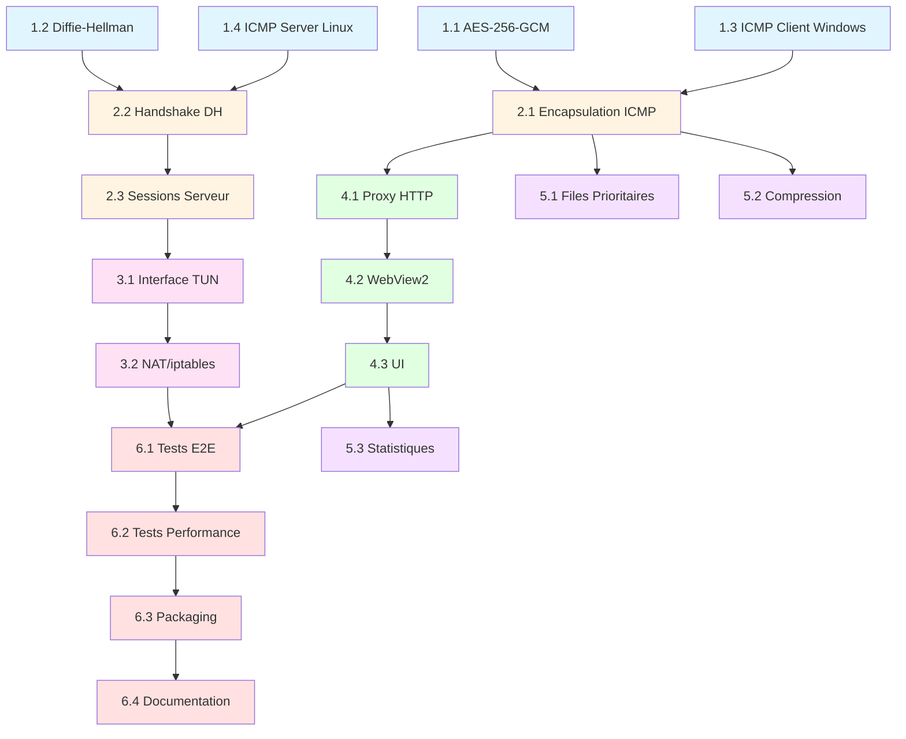

# Implementation Plan

## Overview

This implementation plan covers the development of the ICMP Browser Portable system, consisting of:
- **Client**: Windows application with WebView2 browser and ICMP tunnel client
- **Server**: Linux/Armbian server with TUN/TAP interface and ICMP tunnel server
- **Protocol**: Secure ICMP tunnel with AES-256-GCM encryption and Diffie-Hellman key exchange

The plan is organized into 6 phases with 19 tasks, progressing from foundational cryptographic components through protocol implementation, network interfaces, user interface, optimizations, and final testing/deployment.

## Tasks

### Phase 1: Fondations et Crypto (Client + Serveur)

- [ ] 1.1 Implémentation du chiffrement AES-256-GCM
**Status:** todo
**Priority:** high
**Estimated Time:** 4h

**Description:**
Implémenter les fonctions de chiffrement/déchiffrement AES-256-GCM pour sécuriser les payloads ICMP.

**Implementation Details:**
- Utiliser OpenSSL (libcrypto) pour AES-GCM
- Fonctions: `aes_gcm_encrypt()` et `aes_gcm_decrypt()`
- IV de 96 bits généré aléatoirement
- Auth tag de 128 bits
- Support des associated data (session_id + sequence)

**Files to Create:**
- `src/crypto/aes_gcm.h`
- `src/crypto/aes_gcm.c`
- `tests/test_aes_gcm.c`

**Tests:**
```c
// Test 1: Round-trip encryption/decryption
uint8_t plaintext[] = "Hello ICMP Tunnel";
uint8_t key[32];  // Clé AES-256
uint8_t iv[12];
uint8_t ciphertext[256];
uint8_t auth_tag[16];
uint8_t decrypted[256];

aes_gcm_encrypt(key, iv, plaintext, sizeof(plaintext), NULL, 0, 
                ciphertext, auth_tag);
int result = aes_gcm_decrypt(key, iv, ciphertext, sizeof(plaintext), 
                              auth_tag, NULL, 0, decrypted);
assert(result == 0);
assert(memcmp(plaintext, decrypted, sizeof(plaintext)) == 0);

// Test 2: Authentication failure avec tag modifié
auth_tag[0] ^= 0xFF;  // Corrompre le tag
result = aes_gcm_decrypt(key, iv, ciphertext, sizeof(plaintext), 
                         auth_tag, NULL, 0, decrypted);
assert(result == -1);  // Devrait échouer
```

---

- [ ] 1.2 Implémentation de Diffie-Hellman
**Status:** todo
**Priority:** high
**Estimated Time:** 3h

**Description:**
Implémenter l'échange de clés Diffie-Hellman 2048-bit pour établir une clé de session partagée.

**Implementation Details:**
- Utiliser OpenSSL pour DH
- Paramètres: P (2048-bit prime), G=2
- Dérivation de clé avec HKDF-SHA256
- Génération de clés publiques/privées

**Files to Create:**
- `src/crypto/diffie_hellman.h`
- `src/crypto/diffie_hellman.c`
- `tests/test_dh.c`

**Tests:**
```c
// Test: Client et serveur obtiennent la même clé
dh_context_t client_ctx, server_ctx;

dh_init(&client_ctx);
dh_init(&server_ctx);

uint8_t client_public[256], server_public[256];
dh_generate_keypair(&client_ctx, client_public);
dh_generate_keypair(&server_ctx, server_public);

uint8_t client_shared[256], server_shared[256];
dh_compute_shared_secret(&client_ctx, server_public, client_shared);
dh_compute_shared_secret(&server_ctx, client_public, server_shared);

assert(memcmp(client_shared, server_shared, 256) == 0);
```

---

- [ ] 1.3 Bibliothèque ICMP Client (Windows Icmp.dll)
**Status:** todo
**Priority:** high
**Estimated Time:** 6h

**Description:**
Créer une bibliothèque d'abstraction pour l'API Windows Icmp.dll avec support du threading et des files d'attente.

**Implementation Details:**
- Wrapper autour de IcmpCreateFile, IcmpSendEcho, IcmpSendEcho2
- Support multi-threaded (send + receive threads)
- File d'attente prioritaire pour les paquets sortants
- Gestion des timeouts et retransmissions

**Files to Create:**
- `src/client/icmp_engine.h`
- `src/client/icmp_engine.c`
- `tests/test_icmp_engine.c`

**Tests:**
```c
// Test 1: Envoi/réception basique (test_icmp_dll.exe existant)
icmp_session_t *session = icmp_session_create("8.8.8.8");
assert(session != NULL);

uint8_t payload[] = "TEST_PAYLOAD";
int result = icmp_send_packet(session, payload, sizeof(payload));
assert(result == 0);

uint8_t reply[1024];
size_t reply_size;
result = icmp_wait_reply(session, reply, &reply_size, 5000);
assert(result == 0);
assert(memcmp(reply, payload, sizeof(payload)) == 0);

icmp_session_destroy(session);

// Test 2: Gestion du timeout
result = icmp_send_packet(session, payload, sizeof(payload));
reply_size = 0;
result = icmp_wait_reply(session, reply, &reply_size, 100);  // Timeout court
assert(result == ICMP_TIMEOUT);
```

---

- [ ] 1.4 Bibliothèque ICMP Serveur (Linux Raw Sockets)
**Status:** todo
**Priority:** high
**Estimated Time:** 6h

**Description:**
Créer la bibliothèque serveur pour recevoir/envoyer des paquets ICMP via raw sockets POSIX.

**Implementation Details:**
- Raw socket avec IPPROTO_ICMP
- Filtrage par type ICMP (Echo Request uniquement)
- Parsing des headers IP + ICMP
- Construction manuelle des paquets ICMP Echo Reply

**Files to Create:**
- `src/server/icmp_handler.h`
- `src/server/icmp_handler.c`
- `tests/test_icmp_handler.c`

**Tests:**
```c
// Test 1: Création du raw socket (nécessite root)
int sock_fd = icmp_open_raw_socket();
assert(sock_fd > 0);

// Test 2: Réception d'un paquet ICMP
icmp_packet_t packet;
int result = icmp_receive_packet(sock_fd, &packet, 5000);
assert(result == 0);
assert(packet.type == ICMP_ECHO_REQUEST);

// Test 3: Envoi d'une réponse ICMP Echo Reply
packet.type = ICMP_ECHO_REPLY;
result = icmp_send_reply(sock_fd, &packet);
assert(result == 0);
```

---

### Phase 2: Encapsulation et Protocole

- [ ] 2.1 Encapsulation/Décapsulation ICMP (Client)
**Status:** todo
**Priority:** high
**Estimated Time:** 5h

**Description:**
Implémenter l'encapsulation des paquets IP dans des payloads ICMP chiffrés, avec support de la fragmentation.

**Implementation Details:**
- Fragmentation si IP packet > 1432 bytes
- Format: IV (12) + Ciphertext + AuthTag (16)
- Numérotation de séquence
- Flags de fragmentation (0x01 = more, 0x00 = last)

**Files to Create:**
- `src/client/encapsulation.h`
- `src/client/encapsulation.c`
- `tests/test_encapsulation.c`

**Tests:**
```c
// Test 1: Encapsulation d'un petit paquet (pas de fragmentation)
uint8_t ip_packet[100] = {/* IP header + data */};
icmp_session_t *session = create_test_session();

icmp_packet_t *icmp_packets = encapsulate_ip_packet(ip_packet, 100, session);
assert(icmp_packets != NULL);
assert(icmp_packets[0].flags == 0x00);  // Un seul fragment

// Test 2: Encapsulation d'un gros paquet (avec fragmentation)
uint8_t large_packet[3000];
icmp_packets = encapsulate_ip_packet(large_packet, 3000, session);
assert(icmp_packets != NULL);
assert(icmp_packets[0].flags == 0x01);  // Plus de fragments
assert(icmp_packets[1].flags == 0x01);
assert(icmp_packets[2].flags == 0x00);  // Dernier fragment

// Test 3: Décapsulation et réassemblage
uint8_t reconstructed[3000];
size_t size = decapsulate_and_reassemble(icmp_packets, reconstructed, session);
assert(size == 3000);
assert(memcmp(reconstructed, large_packet, 3000) == 0);
```

---

- [ ] 2.2 Handshake DH via ICMP
**Status:** todo
**Priority:** high
**Estimated Time:** 4h

**Description:**
Implémenter le handshake Diffie-Hellman pour établir la clé de session au démarrage du tunnel.

**Implementation Details:**
- Paquet ICMP spécial (Seq=0) pour échange DH
- Client envoie sa clé publique DH
- Serveur répond avec sa clé publique DH
- Dérivation de la clé de session via HKDF

**Files to Create:**
- `src/common/handshake.h`
- `src/client/handshake_client.c`
- `src/server/handshake_server.c`
- `tests/test_handshake.c`

**Tests:**
```c
// Test: Handshake complet client-serveur
// (nécessite un serveur de test ou mock)
icmp_session_t *client_session = icmp_session_create("127.0.0.1");
client_session_t *server_session = server_create_session(client_ip);

// Client initie le handshake
int result = client_initiate_handshake(client_session);
assert(result == 0);

// Serveur reçoit et répond
result = server_handle_handshake(server_session, handshake_packet);
assert(result == 0);

// Client finalise
result = client_finalize_handshake(client_session, response_packet);
assert(result == 0);

// Vérifier que les deux ont la même clé
assert(memcmp(client_session->session_key, 
              server_session->session_key, 32) == 0);
```

---

- [ ] 2.3 Gestion des Sessions Serveur
**Status:** todo
**Priority:** medium
**Estimated Time:** 4h

**Description:**
Implémenter la table de sessions côté serveur pour gérer plusieurs clients simultanés.

**Implementation Details:**
- Hash map (session_id -> client_session)
- Thread-safe (pthread_rwlock)
- Timeout des sessions inactives (5 minutes)
- Thread de nettoyage périodique

**Files to Create:**
- `src/server/session_table.h`
- `src/server/session_table.c`
- `tests/test_session_table.c`

**Tests:**
```c
// Test 1: Ajout et recherche de sessions
session_table_t *table = session_table_create(100);
client_session_t *session1 = create_test_session(0x1234);
session_table_add(table, session1);

client_session_t *found = session_table_find(table, 0x1234);
assert(found == session1);

// Test 2: Timeout des sessions
session1->last_activity = time(NULL) - 400;  // 400 secondes d'inactivité
session_table_cleanup_expired(table, 300);  // Timeout = 300s
found = session_table_find(table, 0x1234);
assert(found == NULL);  // Devrait être supprimée
```

---

### Phase 3: Interface TUN/TAP et Routage (Serveur)

- [ ] 3.1 Gestion de l'interface TUN (Serveur Linux)
**Status:** todo
**Priority:** high
**Estimated Time:** 5h

**Description:**
Implémenter la création et la gestion de l'interface TUN virtuelle pour injection/extraction de paquets IP.

**Implementation Details:**
- Ouverture de /dev/net/tun
- Configuration ioctl (TUNSETIFF)
- Lecture/écriture de paquets IP
- Configuration IP (10.0.1.1/24)

**Files to Create:**
- `src/server/tun_device.h`
- `src/server/tun_device.c`
- `tests/test_tun_device.c`

**Tests:**
```c
// Test 1: Création de l'interface TUN (nécessite root)
int tun_fd = tun_create("tun0");
assert(tun_fd > 0);

// Test 2: Configuration IP
int result = tun_configure(tun_fd, "10.0.1.1", "255.255.255.0");
assert(result == 0);

// Test 3: Injection d'un paquet IP
uint8_t ip_packet[100] = {/* paquet IP valide */};
result = tun_write(tun_fd, ip_packet, 100);
assert(result == 100);

// Test 4: Lecture d'un paquet IP (timeout)
uint8_t buffer[2048];
result = tun_read_timeout(tun_fd, buffer, sizeof(buffer), 1000);
assert(result > 0 || result == TUN_TIMEOUT);
```

---

- [ ] 3.2 Configuration NAT et iptables (Serveur)
**Status:** todo
**Priority:** medium
**Estimated Time:** 3h

**Description:**
Créer les scripts de configuration réseau pour le serveur (NAT, forwarding, masquerading).

**Implementation Details:**
- Script Bash pour Armbian
- Configuration iptables pour NAT
- Activation du IP forwarding
- Désactivation des réponses ICMP automatiques

**Files to Create:**
- `scripts/server_setup.sh`
- `scripts/server_teardown.sh`
- `scripts/armbian_specific.sh`

**Tests:**
```bash
# Test 1: Vérifier que le script configure correctement
sudo ./scripts/server_setup.sh
assert ip link show tun0
assert cat /proc/sys/net/ipv4/ip_forward == 1
assert iptables -t nat -L | grep MASQUERADE

# Test 2: Tester le routage
# (depuis un client, faire un ping vers 10.0.1.1)
ping -c 1 10.0.1.1
assert $? == 0
```

---

### Phase 4: Proxy HTTP et Intégration WebView2 (Client)

- [ ] 4.1 Serveur Proxy HTTP Local
**Status:** todo
**Priority:** high
**Estimated Time:** 8h

**Description:**
Implémenter un serveur proxy HTTP local (127.0.0.1:8888) pour intercepter les requêtes du navigateur.

**Implementation Details:**
- Socket TCP écoutant sur localhost:8888
- Parsing des requêtes HTTP/1.1
- Conversion HTTP -> paquets IP
- Envoi via ICMP tunnel
- Réception des réponses IP
- Conversion IP -> réponse HTTP

**Files to Create:**
- `src/client/http_proxy.h`
- `src/client/http_proxy.cpp`
- `tests/test_http_proxy.c`

**Tests:**
```c
// Test 1: Proxy accepte les connexions
http_proxy_t *proxy = http_proxy_create(8888);
http_proxy_start(proxy);

// Connexion test depuis un client
SOCKET client = socket(AF_INET, SOCK_STREAM, IPPROTO_TCP);
struct sockaddr_in addr;
addr.sin_family = AF_INET;
addr.sin_addr.s_addr = inet_addr("127.0.0.1");
addr.sin_port = htons(8888);
int result = connect(client, (sockaddr*)&addr, sizeof(addr));
assert(result == 0);

// Test 2: Proxy parse une requête HTTP
char request[] = "GET / HTTP/1.1\r\nHost: example.com\r\n\r\n";
send(client, request, strlen(request), 0);

// Attendre la réponse (simulée)
char response[4096];
int bytes = recv(client, response, sizeof(response), 0);
assert(bytes > 0);
assert(strstr(response, "HTTP/1.1") != NULL);
```

---

- [ ] 4.2 Intégration WebView2
**Status:** todo
**Priority:** high
**Estimated Time:** 6h

**Description:**
Créer l'application Windows avec WebView2 et configurer le proxy.

**Implementation Details:**
- Fenêtre Win32 avec WebView2
- Configuration du proxy (--proxy-server=http://127.0.0.1:8888)
- Barre d'adresse et boutons de navigation
- Indicateur de statut de connexion

**Files to Create:**
- `src/client/ui/main_window.cpp`
- `src/client/ui/webview_controller.cpp`
- `src/client/ui/settings_dialog.cpp`

**Tests:**
```cpp
// Test 1: Création de la fenêtre
MainWindow *window = new MainWindow();
assert(window->Create());
assert(window->IsVisible());

// Test 2: WebView2 est initialisé
WebViewController *controller = window->GetWebViewController();
assert(controller != nullptr);
assert(controller->IsInitialized());

// Test 3: Navigation vers une URL
controller->Navigate(L"https://example.com");
// Attendre le chargement
Sleep(2000);
wchar_t *url = controller->GetCurrentURL();
assert(wcscmp(url, L"https://example.com") == 0);
```

---

- [ ] 4.3 Interface Utilisateur (UI)
**Status:** todo
**Priority:** medium
**Estimated Time:** 6h

**Description:**
Créer l'interface utilisateur complète avec barre d'outils, statut, et paramètres.

**Implementation Details:**
- Barre d'outils avec boutons (back, forward, reload, home)
- Barre d'adresse avec autocomplétion
- Barre de statut (connexion, débit)
- Dialog de paramètres (serveur proxy, débit max, etc.)

**Files to Create:**
- `src/client/ui/toolbar.cpp`
- `src/client/ui/address_bar.cpp`
- `src/client/ui/status_bar.cpp`
- `resources/icons.rc`

**Tests:**
```cpp
// Test 1: Barre d'outils fonctionne
Toolbar *toolbar = new Toolbar(window);
toolbar->Create();
assert(toolbar->GetButtonCount() == 4);  // Back, Forward, Reload, Home

// Test 2: Barre de statut affiche les infos
StatusBar *statusbar = new StatusBar(window);
statusbar->SetConnectionStatus(true, "192.168.1.100");
wchar_t *text = statusbar->GetText();
assert(wcsstr(text, L"192.168.1.100") != NULL);
```

---

### Phase 5: Optimisations et Performance

- [ ] 5.1 Files d'Attente Prioritaires
**Status:** todo
**Priority:** medium
**Estimated Time:** 4h

**Description:**
Implémenter un système de files d'attente avec priorités pour optimiser l'envoi des paquets.

**Implementation Details:**
- 3 niveaux de priorité (HIGH, NORMAL, LOW)
- Prioriser DNS et handshakes (HIGH)
- Requêtes HTTP normales (NORMAL)
- Images et ressources statiques (LOW)

**Files to Create:**
- `src/common/priority_queue.h`
- `src/common/priority_queue.c`
- `tests/test_priority_queue.c`

**Tests:**
```c
// Test: Dequeue respecte les priorités
priority_queue_t *pq = pq_create(1000);
pq_enqueue(pq, packet1, PRIORITY_LOW);
pq_enqueue(pq, packet2, PRIORITY_HIGH);
pq_enqueue(pq, packet3, PRIORITY_NORMAL);

icmp_packet_t *p = pq_dequeue(pq);
assert(p == packet2);  // HIGH en premier
p = pq_dequeue(pq);
assert(p == packet3);  // NORMAL ensuite
p = pq_dequeue(pq);
assert(p == packet1);  // LOW en dernier
```

---

- [ ] 5.2 Compression zlib
**Status:** todo
**Priority:** low
**Estimated Time:** 3h

**Description:**
Ajouter la compression des payloads avec zlib pour réduire la bande passante.

**Implementation Details:**
- Compression avant chiffrement
- Décompression après déchiffrement
- Option activable/désactivable

**Files to Create:**
- `src/common/compression.h`
- `src/common/compression.c`
- `tests/test_compression.c`

**Tests:**
```c
// Test: Compression réduit la taille
uint8_t input[1000];
memset(input, 'A', 1000);  // Données répétitives
uint8_t compressed[1024];
size_t compressed_size = compress_payload(input, 1000, compressed, 1024);
assert(compressed_size < 100);  // Devrait être très compressé

// Test: Décompression restaure l'original
uint8_t decompressed[1000];
size_t decompressed_size = decompress_payload(compressed, compressed_size, 
                                               decompressed, 1000);
assert(decompressed_size == 1000);
assert(memcmp(input, decompressed, 1000) == 0);
```

---

- [ ] 5.3 Statistiques et Monitoring
**Status:** todo
**Priority:** low
**Estimated Time:** 3h

**Description:**
Implémenter le système de statistiques pour mesurer débit, latence, paquets perdus.

**Implementation Details:**
- Compteurs de paquets envoyés/reçus
- Mesure du RTT moyen
- Calcul du débit (bytes/sec)
- Taux de perte de paquets

**Files to Create:**
- `src/common/statistics.h`
- `src/common/statistics.c`
- `src/client/ui/stats_window.cpp`

**Tests:**
```c
// Test: Statistiques sont mises à jour
statistics_t *stats = stats_create();
stats_packet_sent(stats, 100);  // 100 bytes envoyés
stats_packet_received(stats, 80, 25);  // 80 bytes reçus, RTT=25ms

assert(stats_get_packets_sent(stats) == 1);
assert(stats_get_packets_received(stats) == 1);
assert(stats_get_average_rtt(stats) == 25);
assert(stats_get_packet_loss_rate(stats) == 0.0);
```

---

### Phase 6: Tests d'Intégration et Déploiement

- [ ] 6.1 Tests End-to-End Client-Serveur
**Status:** todo
**Priority:** high
**Estimated Time:** 8h

**Description:**
Créer une suite de tests d'intégration complète client-serveur.

**Implementation Details:**
- Serveur de test local sur WSL
- Client Windows se connectant au serveur local
- Tests automatisés de navigation HTTP
- Vérification de l'intégrité des données

**Files to Create:**
- `tests/integration/test_e2e.sh`
- `tests/integration/test_server.c`
- `tests/integration/test_scenarios.cpp`

**Tests:**
```bash
# Test 1: Handshake réussit
./test_server &
SERVER_PID=$!
./icmp_browser_client --server 127.0.0.1 --test-handshake
assert $? == 0
kill $SERVER_PID

# Test 2: Requête HTTP complète
./test_server &
SERVER_PID=$!
# Requête HTTP via le tunnel
curl --proxy http://127.0.0.1:8888 http://example.com > /tmp/response.html
assert [ -s /tmp/response.html ]
assert grep "<html>" /tmp/response.html
kill $SERVER_PID
```

---

- [ ] 6.2 Tests de Performance et Charge
**Status:** todo
**Priority:** medium
**Estimated Time:** 4h

**Description:**
Mesurer les performances du système sous charge.

**Implementation Details:**
- Tests de latence (RTT)
- Tests de débit (throughput)
- Tests de charge (100 requêtes simultanées)
- Mesure de l'utilisation CPU/mémoire

**Files to Create:**
- `tests/performance/benchmark.sh`
- `tests/performance/load_test.c`

**Tests:**
```bash
# Test 1: Latence moyenne < 100ms
./benchmark --test latency --samples 100
LATENCY=$(cat benchmark_results.txt | grep "Average RTT" | awk '{print $3}')
assert [ $LATENCY -lt 100 ]

# Test 2: Débit > 1 Mbps
./benchmark --test throughput --duration 10
THROUGHPUT=$(cat benchmark_results.txt | grep "Throughput" | awk '{print $2}')
assert [ $THROUGHPUT -gt 1000000 ]  # 1 Mbps = 1000000 bps
```

---

- [ ] 6.3 Packaging et Distribution
**Status:** todo
**Priority:** medium
**Estimated Time:** 4h

**Description:**
Créer les packages de distribution pour client et serveur.

**Implementation Details:**
- Client: exécutable portable Windows (.exe)
- Serveur: package Debian (.deb) pour Armbian
- Scripts d'installation
- Documentation utilisateur

**Files to Create:**
- `packaging/windows/build.bat`
- `packaging/debian/build.sh`
- `packaging/debian/icmp-server.service`
- `docs/USER_GUIDE.md`

**Deliverables:**
```
# Client Windows
ICMPBrowser-v1.0-win64.zip
├── ICMPBrowser.exe
├── config_example.ini
├── README.txt
└── LICENSE.txt

# Serveur Debian/Armbian
icmp-server_1.0_arm64.deb
icmp-server_1.0_armhf.deb
```

---

- [ ] 6.4 Documentation Complète
**Status:** todo
**Priority:** medium
**Estimated Time:** 4h

**Description:**
Rédiger la documentation utilisateur et développeur.

**Files to Create:**
- `docs/USER_GUIDE.md` - Guide utilisateur
- `docs/DEVELOPER_GUIDE.md` - Guide développeur
- `docs/SECURITY.md` - Considérations de sécurité
- `docs/TROUBLESHOOTING.md` - Résolution de problèmes

**Content:**
- Installation pas-à-pas
- Configuration du serveur Armbian
- Utilisation du client
- FAQ
- Architecture technique
- API documentation

---

## Notes

- **Privilèges** : Le client ne nécessite PAS de droits admin (validé par test). Le serveur nécessite root pour raw sockets et TUN/TAP.
- **Plateformes** : Client = Windows 10/11 (x64/ARM64), Serveur = Linux/Armbian (x64/ARM)
- **Dépendances** : 
  - Client: WebView2 Runtime, OpenSSL, zlib
  - Serveur: OpenSSL, zlib, iptables
- **Sécurité** : Utilisation responsable uniquement. Ne pas utiliser pour contourner des restrictions légales.

## Task Dependency Graph

```json
{
  "waves": [
    {
      "name": "Wave 1: Crypto Foundation",
      "tasks": ["1.1", "1.2"],
      "description": "Core cryptographic primitives"
    },
    {
      "name": "Wave 2: ICMP Infrastructure",
      "tasks": ["1.3", "1.4"],
      "description": "Platform-specific ICMP handling",
      "dependsOn": ["Wave 1"]
    },
    {
      "name": "Wave 3: Protocol Layer",
      "tasks": ["2.1", "2.2", "2.3"],
      "description": "Encapsulation and handshake protocol",
      "dependsOn": ["Wave 2"]
    },
    {
      "name": "Wave 4: Server Networking",
      "tasks": ["3.1", "3.2"],
      "description": "TUN/TAP and routing configuration",
      "dependsOn": ["Wave 3"]
    },
    {
      "name": "Wave 5: Client Application",
      "tasks": ["4.1", "4.2", "4.3"],
      "description": "HTTP proxy and browser UI",
      "dependsOn": ["Wave 3"]
    },
    {
      "name": "Wave 6: Optimizations",
      "tasks": ["5.1", "5.2", "5.3"],
      "description": "Performance enhancements (can run in parallel)",
      "dependsOn": ["Wave 3"]
    },
    {
      "name": "Wave 7: Integration & Deployment",
      "tasks": ["6.1", "6.2", "6.3", "6.4"],
      "description": "End-to-end testing and packaging",
      "dependsOn": ["Wave 4", "Wave 5"]
    }
  ]
}
```



### Critical Path
1. Phase 1: Fondations (1.1-1.4) - 19h
2. Phase 2: Protocole (2.1-2.3) - 13h
3. Phase 3: TUN/TAP (3.1-3.2) - 8h
4. Phase 4: UI/Proxy (4.1-4.3) - 20h
5. Phase 6: Tests/Deploy (6.1-6.4) - 20h

Total critical path: **80h**

Phase 5 (Optimisations) can be done in parallel with other phases as these are enhancements.

### Parallel Work Opportunities
- Tasks 1.1 and 1.2 can be done in parallel (both crypto)
- Tasks 1.3 and 1.4 can be done in parallel (client vs server ICMP)
- Tasks 5.1, 5.2, 5.3 can be done anytime after their dependencies are met
- Documentation (6.4) can start early and be updated throughout
wp