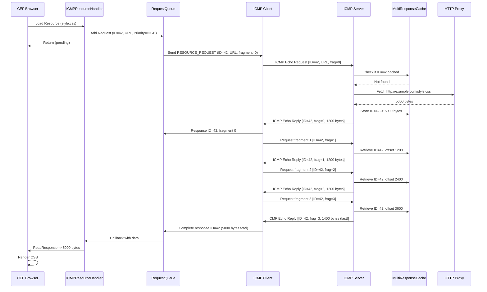

# Design Document: ICMP Resource Interception

## Overview

This design implements complete resource interception for the ICMP Browser, extending the existing single-request HTTP-over-ICMP tunnel to support multiple concurrent resource requests. The current implementation successfully loads HTML documents but fails to load CSS, JavaScript, images, and other sub-resources because CEF attempts direct HTTP connections. This design adds CEF resource handlers that intercept all requests, queue them with priorities, transmit them through the ICMP tunnel using unique request IDs, and assemble fragmented responses.

**Architecture Pattern**: Client-Server with Request Queue and Multi-Cache

**Key Changes**:
- Client: Add `CefResourceRequestHandler` and `CefResourceHandler` implementations
- Client: Add request queue with priority management
- Client: Extend ICMP protocol with request IDs (2 bytes)
- Server: Replace single-response cache with multi-slot cache (50 entries)
- Server: Add request ID matching and concurrent HTTP fetching
- Protocol: Define new packet types RESOURCE_REQUEST (0x05) and RESOURCE_RESPONSE (0x06)

## Architecture

### Component Overview

```
CEF Browser Process
├── CefResourceRequestHandler (NEW)
│   ├── Intercepts all resource requests (HTML, CSS, JS, images, fonts)
│   └── Returns custom CefResourceHandler for tunneled loading
│
├── ICMPResourceHandler (NEW)
│   ├── Implements CefResourceHandler interface
│   ├── Generates request ID, adds to queue
│   ├── Reads response data from queue when available
│   └── Provides data to CEF via ReadResponse callback
│
├── ResourceRequestQueue (NEW)
│   ├── Stores pending requests with callbacks
│   ├── Assigns priorities based on resource type
│   ├── Matches incoming responses by request ID
│   └── Thread-safe with mutex protection
│
├── ICMP Sender Thread
│   ├── Sends resource requests with request IDs
│   ├── Prioritizes high-priority requests
│   └── Handles fragment requests (chunk 0, 1, 2...)
│
└── ICMP Receiver Thread
    ├── Receives resource responses
    ├── Matches responses to queued requests by ID
    └── Triggers callbacks for complete responses

ICMP Server Process
├── ICMP Receiver
│   ├── Receives RESOURCE_REQUEST packets
│   ├── Extracts request ID and URL
│   └── Dispatches to HTTP Proxy
│
├── MultiResponseCache (NEW)
│   ├── 50-entry cache (hash map or array)
│   ├── Each entry: request_id, response_data[10MB], size, timestamp
│   ├── LRU eviction when full
│   └── 60-second expiration per entry
│
├── HTTP Proxy Worker
│   ├── Performs HTTP GET/POST with libcurl
│   ├── Stores response in cache by request ID
│   └── Supports concurrent requests (async or thread pool)
│
└── ICMP Sender
    ├── Sends RESOURCE_RESPONSE fragments
    ├── Retrieves from cache by request ID
    └── Sends 1200-byte chunks on demand
```

### Request Flow Diagram



## Components and Interfaces

### Client-Side Components (C++)

#### 1. ICMPResourceRequestHandler (src/browser/icmp_resource_handler.h)

Intercepts all CEF resource requests and returns custom handlers.

```cpp
class ICMPResourceRequestHandler : public CefResourceRequestHandler {
public:
    // Called for every resource request
    CefRefPtr<CefResourceHandler> GetResourceHandler(
        CefRefPtr<CefBrowser> browser,
        CefRefPtr<CefFrame> frame,
        CefRefPtr<CefRequest> request) override;
    
private:
    IMPLEMENT_REFCOUNTING(ICMPResourceRequestHandler);
};
```

**Key Responsibilities**:
- Intercept all resource requests from CEF
- Determine if request should use ICMP tunnel (all HTTP/HTTPS requests)
- Create and return `ICMPResourceHandler` instances
- Pass request URL, method, and headers to handler

#### 2. ICMPResourceHandler (src/browser/icmp_resource_handler.h)

Custom resource handler that loads data through ICMP tunnel.

```cpp
class ICMPResourceHandler : public CefResourceHandler {
public:
    ICMPResourceHandler(const std::string& url, const std::string& method);
    
    // CefResourceHandler interface
    bool Open(CefRefPtr<CefRequest> request, 
             bool& handle_request,
             CefRefPtr<CefCallback> callback) override;
    
    void GetResponseHeaders(CefRefPtr<CefResponse> response,
                           int64& response_length,
                           CefString& redirectUrl) override;
    
    bool Read(void* data_out,
             int bytes_to_read,
             int& bytes_read,
             CefRefPtr<CefResourceReadCallback> callback) override;
    
    void Cancel() override;
    
private:
    std::string url_;
    std::string method_;
    uint16_t request_id_;
    std::vector<uint8_t> response_data_;
    size_t read_offset_;
    bool completed_;
    
    IMPLEMENT_REFCOUNTING(ICMPResourceHandler);
};
```

**Key Responsibilities**:
- Generate unique request ID (incremental counter with wraparound)
- Add request to global `ResourceRequestQueue`
- Wait for response data via callback mechanism
- Provide response data to CEF via `Read()` calls
- Parse HTTP headers from response (first line until \r\n\r\n)
- Handle cancellation and cleanup

#### 3. ResourceRequestQueue (src/browser/resource_queue.h)

Thread-safe queue managing multiple concurrent requests.

```cpp
struct ResourceRequest {
    uint16_t request_id;
    std::string url;
    std::string method;
    std::map<std::string, std::string> headers;
    int priority;  // 3=high (HTML/CSS), 2=medium (JS), 1=low (images)
    time_t timestamp;
    
    // Response data
    std::vector<uint8_t> response_data;
    bool complete;
    bool failed;
    
    // Callback
    std::function<void(bool success)> callback;
};

class ResourceRequestQueue {
public:
    ResourceRequestQueue();
    ~ResourceRequestQueue();
    
    // Add a request to the queue
    uint16_t AddRequest(const std::string& url, 
                       const std::string& method,
                       int priority,
                       std::function<void(bool)> callback);
    
    // Get next request to send (highest priority)
    bool GetNextPendingRequest(ResourceRequest** request);
    
    // Mark request as sent (waiting for response)
    void MarkRequestSent(uint16_t request_id);
    
    // Add response fragment
    void AddResponseFragment(uint16_t request_id, 
                            const uint8_t* data, 
                            size_t size,
                            bool is_last_fragment);
    
    // Get request by ID
    ResourceRequest* GetRequest(uint16_t request_id);
    
    // Remove completed/failed requests
    void RemoveRequest(uint16_t request_id);
    
    // Timeout management
    void CheckTimeouts();  // Call periodically to fail timed-out requests
    
private:
    std::map<uint16_t, ResourceRequest> requests_;
    std::mutex mutex_;
    uint16_t next_request_id_;
};

// Global instance
extern ResourceRequestQueue g_resource_queue;
```

**Key Responsibilities**:
- Generate sequential request IDs (0-65535, wraparound)
- Store requests with URL, method, headers, priority, timestamp
- Provide thread-safe access with mutex
- Support priority-based request retrieval
- Match incoming fragments to requests
- Trigger callbacks when responses complete
- Implement 30-second timeout per request

#### 4. Protocol Extension (src/common/proto.h)

Extend existing protocol with new packet types.

```c
// Existing packet types
#define PROTO_TYPE_HANDSHAKE_INIT   0x01
#define PROTO_TYPE_HANDSHAKE_REPLY  0x02
#define PROTO_TYPE_DATA             0x03
#define PROTO_TYPE_ACK              0x04

// NEW packet types
#define PROTO_TYPE_RESOURCE_REQUEST  0x05
#define PROTO_TYPE_RESOURCE_RESPONSE 0x06

// RESOURCE_REQUEST payload format:
// [2 bytes: request_id] [2 bytes: url_length] [N bytes: url]

// RESOURCE_RESPONSE payload format:
// [2 bytes: request_id] [1 byte: fragment_num] [N bytes: data]
// Note: fragment_num already exists in proto_header_t, request_id is new
```

**Payload Structures**:

```c
// RESOURCE_REQUEST (type 0x05)
typedef struct {
    uint16_t request_id;      // Unique request identifier
    uint16_t url_length;      // Length of URL string
    char url[1000];           // URL (variable length, max 1000)
} resource_request_payload_t;

// RESOURCE_RESPONSE (type 0x06)
typedef struct {
    uint16_t request_id;      // Matching request identifier
    uint8_t fragment_num;     // Fragment number (0-based)
    uint8_t data[];           // Response data (variable length, max 1200)
} resource_response_payload_t;
```

#### 5. Client Request Sender (src/browser/cef_browser.cpp modifications)

Extend existing ICMP sender to handle multiple concurrent requests.

**New Function**:
```cpp
// Send resource request through ICMP tunnel
int SendResourceRequest(uint16_t request_id, 
                       const std::string& url,
                       uint8_t fragment_num) {
    // Build RESOURCE_REQUEST packet
    resource_request_payload_t payload;
    payload.request_id = htons(request_id);
    payload.url_length = htons(url.size());
    memcpy(payload.url, url.c_str(), url.size());
    
    size_t payload_size = 4 + url.size();
    
    // Encapsulate with existing proto_encapsulate
    proto_packet_t packets[10];
    size_t packet_count;
    
    int result = proto_encapsulate((uint8_t*)&payload, payload_size,
                                  g_sessionKey, g_session->session_id,
                                  data_seq, packets, &packet_count, 10);
    
    // Set packet type to RESOURCE_REQUEST
    packets[0].header.packet_type = PROTO_TYPE_RESOURCE_REQUEST;
    packets[0].header.fragment_num = fragment_num;
    
    // Send via existing icmp_send_reliable
    uint8_t send_buffer[2048];
    memcpy(send_buffer, &packets[0].header, sizeof(proto_header_t));
    memcpy(send_buffer + sizeof(proto_header_t), packets[0].payload, 
           packets[0].payload_size);
    size_t send_size = sizeof(proto_header_t) + packets[0].payload_size;
    
    uint8_t reply_buffer[8192];
    size_t reply_size = 0;
    
    return icmp_send_reliable(g_session, send_buffer, send_size,
                             reply_buffer, &reply_size);
}
```

**Request Loop Thread**:
```cpp
// Background thread that continuously sends pending requests
DWORD WINAPI ResourceRequestSenderThread(LPVOID param) {
    while (g_session && g_session->connected) {
        ResourceRequest* request = nullptr;
        
        // Get next high-priority pending request
        if (g_resource_queue.GetNextPendingRequest(&request)) {
            // Send initial fragment request (fragment 0)
            SendResourceRequest(request->request_id, request->url, 0);
            g_resource_queue.MarkRequestSent(request->request_id);
            
            Sleep(10);  // Rate limiting
        } else {
            Sleep(50);  // No pending requests
        }
        
        // Check for timeouts
        g_resource_queue.CheckTimeouts();
    }
    return 0;
}
```

**Response Handler** (extend existing receiver):
```cpp
// In existing ICMP receive loop
if (packet.header.packet_type == PROTO_TYPE_RESOURCE_RESPONSE) {
    // Extract request ID and fragment data
    resource_response_payload_t* response = 
        (resource_response_payload_t*)decrypted;
    uint16_t request_id = ntohs(response->request_id);
    uint8_t fragment_num = response->fragment_num;
    size_t data_size = decrypted_size - 3;
    
    // Add to queue
    bool is_last = (data_size < 1200);
    g_resource_queue.AddResponseFragment(request_id, response->data, 
                                        data_size, is_last);
    
    // If not last fragment, request next one
    if (!is_last) {
        ResourceRequest* req = g_resource_queue.GetRequest(request_id);
        if (req) {
            SendResourceRequest(request_id, req->url, fragment_num + 1);
        }
    }
}
```

### Server-Side Components (C)

#### 6. Multi-Response Cache (src/server/multi_cache.h)

Replaces single-slot cache with 50-slot hash-map based cache.

```c
#define CACHE_MAX_ENTRIES 50
#define CACHE_MAX_RESPONSE_SIZE (10 * 1024 * 1024)  // 10 MB
#define CACHE_ENTRY_TIMEOUT 60  // seconds

typedef struct {
    uint16_t request_id;
    uint8_t* response_data;
    size_t response_size;
    time_t timestamp;
    uint8_t in_use;
} cache_entry_t;

typedef struct {
    cache_entry_t entries[CACHE_MAX_ENTRIES];
    pthread_mutex_t lock;
} multi_response_cache_t;

// Initialize cache
void cache_init(multi_response_cache_t* cache);

// Store response in cache
int cache_store(multi_response_cache_t* cache, 
               uint16_t request_id,
               const uint8_t* data, 
               size_t size);

// Retrieve response from cache
cache_entry_t* cache_get(multi_response_cache_t* cache, 
                        uint16_t request_id);

// Retrieve fragment from cache
int cache_get_fragment(multi_response_cache_t* cache,
                      uint16_t request_id,
                      uint8_t fragment_num,
                      uint8_t* output,
                      size_t* output_size);

// Evict oldest entry (LRU)
void cache_evict_oldest(multi_response_cache_t* cache);

// Cleanup expired entries
void cache_cleanup_expired(multi_response_cache_t* cache);

// Free cache
void cache_destroy(multi_response_cache_t* cache);
```

**Implementation Notes**:
- Use array-based linear search (simple, sufficient for 50 entries)
- Each entry allocates response_data dynamically (up to 10MB)
- LRU eviction: find entry with oldest timestamp, free and reuse
- Mutex protection for thread safety
- Auto-cleanup of entries older than 60 seconds

#### 7. Server Request Handler (src/server/icmp_handler.c modifications)

Modify existing handler to support multiple concurrent requests.

**Changes to `icmp_session_info_t`**:
```c
// REMOVE old single-cache fields:
// uint8_t cached_response[65536];
// size_t cached_response_size;
// uint16_t cached_data_seq;
// uint8_t cache_valid;

// ADD multi-cache reference:
typedef struct {
    // ... existing fields ...
    multi_response_cache_t* response_cache;  // NEW: per-session cache
} icmp_session_info_t;
```

**Modified Request Handler**:
```c
// In handle_data_packet() function
if (header->packet_type == PROTO_TYPE_RESOURCE_REQUEST) {
    // Parse request
    resource_request_payload_t* req = (resource_request_payload_t*)decrypted;
    uint16_t request_id = ntohs(req->request_id);
    uint16_t url_length = ntohs(req->url_length);
    char url[1024];
    memcpy(url, req->url, url_length);
    url[url_length] = '\0';
    
    uint8_t fragment_num = header->fragment_num;
    
    LOG_VERBOSE("[Server] RESOURCE_REQUEST: ID=%u, fragment=%u, URL=%s\n",
               request_id, fragment_num, url);
    
    // Check if already cached
    cache_entry_t* cached = cache_get(session->response_cache, request_id);
    
    if (!cached && fragment_num == 0) {
        // New request - fetch via HTTP proxy
        uint8_t http_response[CACHE_MAX_RESPONSE_SIZE];
        size_t http_response_size;
        
        LOG_VERBOSE("[Server] Fetching URL: %s\n", url);
        
        int fetch_result = http_proxy_fetch(url, http_response, 
                                           &http_response_size,
                                           sizeof(http_response));
        
        if (fetch_result < 0) {
            LOG_ERROR("[Server] HTTP fetch failed for %s\n", url);
            // Send error response
            return -1;
        }
        
        // Store in cache
        cache_store(session->response_cache, request_id, 
                   http_response, http_response_size);
        
        LOG_VERBOSE("[Server] Cached response: ID=%u, size=%zu\n",
                   request_id, http_response_size);
    }
    
    // Retrieve fragment
    uint8_t fragment_data[1200];
    size_t fragment_size;
    
    int get_result = cache_get_fragment(session->response_cache, request_id,
                                       fragment_num, fragment_data, 
                                       &fragment_size);
    
    if (get_result < 0) {
        LOG_ERROR("[Server] Fragment %u not found for ID=%u\n", 
                 fragment_num, request_id);
        return -1;
    }
    
    // Build response packet
    resource_response_payload_t response;
    response.request_id = htons(request_id);
    response.fragment_num = fragment_num;
    memcpy(response.data, fragment_data, fragment_size);
    
    size_t response_size = 3 + fragment_size;
    
    // Encapsulate and send
    proto_packet_t packets[10];
    size_t packet_count;
    
    proto_encapsulate((uint8_t*)&response, response_size,
                     session->session_key, session->session_id,
                     data_seq, packets, &packet_count, 10);
    
    packets[0].header.packet_type = PROTO_TYPE_RESOURCE_RESPONSE;
    
    // Send via ICMP reply
    icmp_send_reply(server, &session->client_addr, 
                   session->session_id, sequence,
                   (uint8_t*)&packets[0], 
                   sizeof(proto_header_t) + packets[0].payload_size);
}
```

#### 8. HTTP Proxy Modifications (src/server/http_proxy.c)

Extend to support concurrent fetching (non-blocking).

**Current Function**:
```c
int http_proxy_process(const uint8_t* request, size_t request_size,
                      uint8_t* response, size_t* response_size,
                      size_t max_response_size);
```

**New Function** (simplified, synchronous version):
```c
// Fetch URL and return response
int http_proxy_fetch(const char* url,
                    uint8_t* response,
                    size_t* response_size,
                    size_t max_response_size) {
    CURL* curl = curl_easy_init();
    if (!curl) return -1;
    
    // Set URL
    curl_easy_setopt(curl, CURLOPT_URL, url);
    
    // Set timeout
    curl_easy_setopt(curl, CURLOPT_TIMEOUT, 30L);
    
    // Follow redirects
    curl_easy_setopt(curl, CURLOPT_FOLLOWLOCATION, 1L);
    
    // Write callback
    struct response_buffer {
        uint8_t* data;
        size_t size;
        size_t max_size;
    } buffer = { response, 0, max_response_size };
    
    curl_easy_setopt(curl, CURLOPT_WRITEFUNCTION, write_callback);
    curl_easy_setopt(curl, CURLOPT_WRITEDATA, &buffer);
    
    // Perform request
    CURLcode res = curl_easy_perform(curl);
    curl_easy_cleanup(curl);
    
    if (res != CURLE_OK) {
        return -1;
    }
    
    *response_size = buffer.size;
    return 0;
}
```

**Note**: For true concurrent fetching, use:
- Thread pool with worker threads
- Each worker pulls from a request queue, fetches, stores in cache
- Alternative: Use libcurl multi interface for async fetching

## Data Models

### ResourceRequest Structure

```cpp
struct ResourceRequest {
    // Identification
    uint16_t request_id;           // Unique ID (0-65535)
    
    // Request details
    std::string url;               // Full URL
    std::string method;            // GET, POST, etc.
    std::map<std::string, std::string> headers;  // HTTP headers
    
    // Priority and timing
    int priority;                  // 3=high, 2=medium, 1=low
    time_t timestamp;              // Request creation time
    time_t last_activity;          // Last fragment received time
    
    // State
    enum State {
        PENDING,      // Not yet sent
        SENT,         // Request sent, waiting for first fragment
        RECEIVING,    // Receiving fragments
        COMPLETE,     // All fragments received
        FAILED,       // Timeout or error
        CANCELLED     // User cancelled
    } state;
    
    // Response assembly
    std::vector<uint8_t> response_data;  // Accumulated fragments
    uint8_t next_fragment_num;           // Next expected fragment
    bool final_fragment_received;        // Last fragment flag
    
    // Callback
    std::function<void(bool success)> callback;
};
```

### CacheEntry Structure

```c
typedef struct {
    // Identification
    uint16_t request_id;          // Unique ID
    
    // Response data
    uint8_t* response_data;       // Dynamically allocated
    size_t response_size;         // Total size in bytes
    
    // Metadata
    time_t timestamp;             // Cache entry creation time
    uint8_t in_use;               // Entry occupied flag
    
    // Fragment tracking (optional, for debugging)
    uint32_t fragments_sent;      // Number of fragments sent
} cache_entry_t;
```

### Protocol Packet Structures

```c
// RESOURCE_REQUEST packet (type 0x05)
typedef struct {
    uint16_t request_id;          // Big-endian
    uint16_t url_length;          // Big-endian
    char url[1000];               // Variable length
} __attribute__((packed)) resource_request_payload_t;

// RESOURCE_RESPONSE packet (type 0x06)
typedef struct {
    uint16_t request_id;          // Big-endian
    uint8_t fragment_num;         // 0-based fragment number
    uint8_t data[1200];           // Variable length (up to 1200)
} __attribute__((packed)) resource_response_payload_t;
```

## Error Handling

### Client Error Handling

**Timeout Scenarios**:
1. **Request Timeout (30 seconds)**: No response received for initial fragment
   - Action: Mark request as FAILED, invoke callback with success=false
   - CEF Response: HTTP 504 Gateway Timeout
   
2. **Fragment Timeout (5 seconds)**: Fragment N not received after request
   - Action: Retry fragment request up to 3 times
   - After 3 failures: Mark request as FAILED, return HTTP 504

3. **Session Disconnect**: ICMP session lost during request
   - Action: Fail all PENDING and SENT requests with HTTP 503 Service Unavailable
   - CEF Response: HTTP 503

**Error Codes**:
```cpp
enum ResourceErrorCode {
    ERROR_NONE = 0,
    ERROR_TIMEOUT = 1,          // Request timeout
    ERROR_FRAGMENT_LOST = 2,    // Fragment repeatedly lost
    ERROR_SESSION_LOST = 3,     // ICMP session disconnected
    ERROR_SERVER_ERROR = 4,     // Server returned error
    ERROR_CANCELLED = 5,        // User cancelled
    ERROR_INVALID_RESPONSE = 6  // Malformed response
};
```

**HTTP Error Mapping**:
```cpp
int MapErrorToHTTPStatus(ResourceErrorCode error) {
    switch (error) {
        case ERROR_TIMEOUT:
        case ERROR_FRAGMENT_LOST:
            return 504;  // Gateway Timeout
        case ERROR_SESSION_LOST:
            return 503;  // Service Unavailable
        case ERROR_SERVER_ERROR:
            return 502;  // Bad Gateway
        case ERROR_CANCELLED:
            return 499;  // Client Closed Request
        default:
            return 500;  // Internal Server Error
    }
}
```

### Server Error Handling

**HTTP Fetch Failures**:
1. **DNS Resolution Failure**: Cannot resolve hostname
   - Action: Return empty response with error header
   - Consider caching negative results to avoid repeated lookups

2. **Connection Timeout**: Cannot connect to destination server
   - Action: Return HTTP 504 in response body
   - libcurl error: CURLE_OPERATION_TIMEDOUT

3. **HTTP Error (4xx, 5xx)**: Destination server returns error
   - Action: Cache and transmit the error response to client
   - CEF will handle displaying error page

**Cache Overflow**:
- When cache is full (50 entries) and new request arrives
- Action: Evict oldest entry (lowest timestamp), reuse slot
- Log warning if evicting entry less than 10 seconds old

**Memory Limits**:
- Response size exceeds 10 MB
- Action: Truncate response to 10 MB, add header "X-Truncated: true"
- Return partial content to client

## Testing Strategy

### Unit Tests

**Client Unit Tests** (C++ with Google Test):

1. **ResourceRequestQueue Tests**:
   - Test: Add request, verify ID assignment
   - Test: Priority ordering (high before low)
   - Test: Fragment assembly (3 fragments → complete response)
   - Test: Timeout detection after 30 seconds
   - Test: Concurrent access (multi-threaded)

2. **ICMPResourceHandler Tests**:
   - Test: Open() triggers request addition to queue
   - Test: Read() returns data after response complete
   - Test: Cancel() removes request from queue
   - Test: GetResponseHeaders() parses Content-Type correctly

3. **Protocol Encoding Tests**:
   - Test: RESOURCE_REQUEST packet format
   - Test: Request ID byte order (network byte order)
   - Test: URL length encoding and truncation

**Server Unit Tests** (C with CUnit or custom framework):

1. **Multi-Cache Tests**:
   - Test: Store and retrieve by request ID
   - Test: Fragment retrieval (fragment 0, 1, 2...)
   - Test: LRU eviction when full
   - Test: Expiration cleanup after 60 seconds
   - Test: Thread safety (concurrent access)

2. **HTTP Proxy Tests**:
   - Test: Fetch valid URL (http://example.com)
   - Test: Handle redirects (3xx)
   - Test: Timeout after 30 seconds
   - Test: Return error for invalid URL

3. **Request Handler Tests**:
   - Test: Parse RESOURCE_REQUEST packet
   - Test: Generate RESOURCE_RESPONSE packet
   - Test: Match request ID in response
   - Test: Handle missing cache entry gracefully

### Integration Tests

**End-to-End Scenarios**:

1. **Single Resource Load**:
   - Client requests http://example.com/style.css
   - Server fetches and caches
   - Server sends 3 fragments (1200 + 1200 + 500 bytes)
   - Client assembles and provides to CEF
   - Verify: CSS applied to page

2. **Concurrent Resource Load**:
   - Client requests 10 resources simultaneously (CSS, JS, 8 images)
   - Server fetches concurrently
   - Verify: All 10 responses complete within 10 seconds
   - Verify: No request ID collisions

3. **Large Resource Load**:
   - Client requests 5 MB image
   - Server caches and fragments (4167 fragments @ 1200 bytes each)
   - Client assembles all fragments
   - Verify: Image displays correctly

4. **Priority Handling**:
   - Client queues 20 requests (5 high, 5 medium, 10 low priority)
   - Verify: High priority requests sent first
   - Verify: Low priority images load after CSS/JS

5. **Error Recovery**:
   - Simulate lost fragment (server drops packet)
   - Client retries after 5 seconds
   - Verify: Fragment eventually received, request completes

6. **Full Website Load**:
   - Load google.com (HTML + CSS + JS + images)
   - Verify: Page renders correctly
   - Verify: All resources loaded (check network log)
   - Load wikipedia.org
   - Verify: Images display, CSS applied
   
7. **Session Persistence**:
   - Load page 1 (10 resources)
   - Load page 2 (15 resources)
   - Verify: Same session used for all requests
   - Verify: No re-handshake between pages

### Performance Tests

**Latency Measurements**:
- Measure: Time from request initiation to first byte received
- Target: < 500ms for single-fragment responses
- Target: < 2 seconds for 10-fragment responses

**Throughput Tests**:
- Measure: Concurrent requests handled per second
- Target: 20 concurrent requests without blocking
- Target: 100 fragments/second aggregate throughput

**Memory Usage**:
- Measure: Client memory usage with 20 pending requests
- Target: < 50 MB for request queue and buffers
- Measure: Server memory usage with 50 cached responses
- Target: < 100 MB for cache (10 responses @ 10 MB each)

**Cache Efficiency**:
- Measure: Cache hit rate for repeated resources
- Test: Load same page twice, verify cached responses used
- Target: 100% hit rate for resources within 60-second window

### Manual Testing Checklist

1. ☐ Load http://example.com - verify HTML renders
2. ☐ Load http://google.com - verify CSS applied, search works
3. ☐ Load http://wikipedia.org - verify images display, links work
4. ☐ Load http://github.com - verify syntax highlighting (CSS/JS)
5. ☐ Test redirect: http://google.com → https://www.google.com
6. ☐ Test error: http://nonexistent.invalid - verify error page
7. ☐ Test large image: http://example.com/10mb-image.jpg
8. ☐ Test mixed content: HTTPS page with HTTP resources
9. ☐ Monitor logs: Verify request IDs unique, no collisions
10. ☐ Monitor performance: Page load time < 10 seconds

## Implementation Notes

### Thread Safety Considerations

**Client-Side**:
- `ResourceRequestQueue`: Protected by `std::mutex`
- All public methods acquire lock before accessing `requests_` map
- CEF callbacks run on different threads, must use queue mutex

**Server-Side**:
- `multi_response_cache_t`: Protected by `pthread_mutex_t`
- Lock during cache_store, cache_get, cache_get_fragment
- Each session has independent cache (no cross-session locking)

### Performance Optimizations

**Client Optimizations**:
1. **Request Batching**: Send multiple high-priority requests in parallel (up to 5)
2. **Fragment Pipelining**: Request fragment N+1 before receiving fragment N
3. **Response Buffering**: Pre-allocate 10 KB buffers to avoid reallocations
4. **Priority Queue**: Use heap/priority queue for O(log N) retrieval

**Server Optimizations**:
1. **Thread Pool**: Use 4-8 worker threads for concurrent HTTP fetching
2. **Cache Pre-warming**: For common resources (favicon.ico), pre-cache on first request
3. **Fragment Caching**: Keep frequently-accessed fragments in fast buffer
4. **Memory Pooling**: Reuse cache entry allocations to reduce malloc/free overhead

### Backward Compatibility

**Protocol Compatibility**:
- Existing DATA packets (type 0x03) remain unchanged
- New packet types (0x05, 0x06) only used for resource interception
- Old clients can still use original LoadURL functionality
- Server checks packet type and routes accordingly

**Graceful Degradation**:
- If resource interception fails, fall back to direct HTTP (configurable)
- If queue is full, display "Loading..." message to user
- If cache is full, evict oldest entries (not current request)

### Security Considerations

**Request Validation**:
- Validate URL length before copying (prevent buffer overflow)
- Validate request ID range (0-65535)
- Validate fragment numbers (prevent out-of-bounds access)

**Cache Isolation**:
- Each session has independent cache (prevent cross-session data leaks)
- Clear cache on session termination
- Enforce 10 MB response limit (prevent memory exhaustion)

**URL Filtering** (optional future enhancement):
- Block dangerous protocols (file://, javascript:)
- Block private IPs (prevent SSRF attacks)
- Whitelist safe domains for testing

### Debugging and Logging

**Client Logging**:
```cpp
#define LOG_RESOURCE(fmt, ...) \
    OutputDebugStringA(("RESOURCE: " fmt "\n", ##__VA_ARGS__))

// Example usage:
LOG_RESOURCE("Request ID=%u, URL=%s, Priority=%d", 
             request_id, url.c_str(), priority);
```

**Server Logging**:
```c
#define LOG_CACHE(fmt, ...) \
    fprintf(stderr, "[CACHE] " fmt "\n", ##__VA_ARGS__)

// Example usage:
LOG_CACHE("Stored ID=%u, size=%zu bytes", request_id, size);
```

**Metrics Collection**:
- Track: Requests per second, fragments per second
- Track: Average response time, cache hit rate
- Track: Queue depth, concurrent requests
- Output to debug log every 10 seconds

### Configuration Parameters

**Client Configuration** (can be hardcoded or configurable):
```cpp
const int MAX_CONCURRENT_REQUESTS = 20;
const int REQUEST_TIMEOUT_SEC = 30;
const int FRAGMENT_TIMEOUT_SEC = 5;
const int FRAGMENT_RETRY_COUNT = 3;
const int REQUEST_RATE_LIMIT = 100;  // requests per second
```

**Server Configuration**:
```c
#define CACHE_MAX_ENTRIES 50
#define CACHE_MAX_RESPONSE_SIZE (10 * 1024 * 1024)
#define CACHE_ENTRY_TIMEOUT 60
#define HTTP_FETCH_TIMEOUT 30
#define HTTP_MAX_REDIRECTS 5
```

## Future Enhancements

1. **HTTP/2 Support**: Support HTTP/2 requests from CEF
2. **Cookie Management**: Persist cookies across requests
3. **Cache Persistence**: Save cache to disk for offline viewing
4. **Compression**: Gzip compress responses before fragmentation
5. **WebSocket Tunneling**: Extend to support WebSocket connections
6. **Request Cancellation**: Allow CEF to cancel pending requests
7. **Progress Reporting**: Report loading progress to CEF UI
8. **Adaptive Fragment Size**: Adjust fragment size based on latency
9. **Request Coalescing**: Merge identical concurrent requests
10. **HTTP POST Support**: Extend to support POST with request bodies

---

## Summary

This design extends the ICMP Browser to support full resource interception by:
- **Client**: Adding CEF resource handlers, request queue with priorities, and request ID management
- **Server**: Replacing single-slot cache with 50-slot multi-cache and supporting concurrent HTTP fetching
- **Protocol**: Extending with RESOURCE_REQUEST/RESPONSE packet types and request IDs
- **Testing**: Comprehensive unit, integration, and manual tests to verify Google, Wikipedia load correctly

The implementation maintains the existing protocol's encryption, fragmentation, and reliability while adding the concurrency needed for modern websites with 50+ resources per page.
